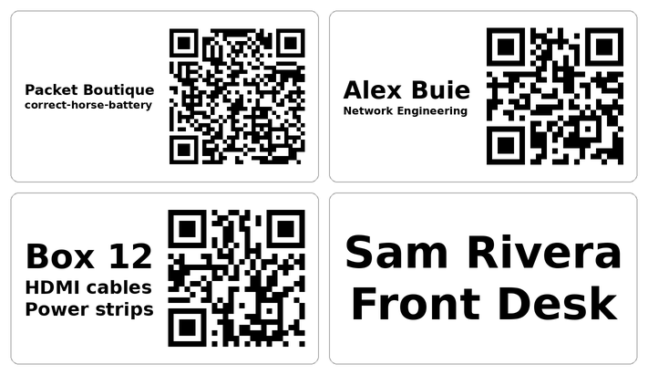

# dymonite

Print text and QR code labels on a DYMO LabelWriter: Wi-Fi stickers, name badges, box labels.
It renders a PNG at the printer's 300 dpi and hands it to CUPS with `lp`, so it works anywhere
the printer already works (macOS, Linux).



## Install

Download a build from [Releases](https://github.com/ab2525/dymonite/releases), no Python needed:

```sh
curl -sSL https://github.com/ab2525/dymonite/releases/latest/download/dymonite-macos-arm64.tar.gz | tar xz
./dymonite --help        # or move it onto your PATH
```

(`dymonite-linux-x86_64.tar.gz` for Linux. A copy downloaded with a browser on macOS needs
`xattr -d com.apple.quarantine dymonite` first.)

Or install it as a Python tool (3.10+):

```sh
uv tool install git+https://github.com/ab2525/dymonite    # or: pipx install git+https://...
```

## Set up

```sh
lpstat -e                                   # your printer's CUPS name
export DYMONITE_PRINTER=DYMO_LabelWriter_400
dymonite sizes                              # the label sizes it takes, in mm and inches
```

The default size is `w162h90`: 2-1/4 x 1-1/4 in (57 x 32 mm, DYMO 30334). Pick another with
`-s` or `DYMONITE_SIZE`. The numbers are points (1/72 in), width across the print head first.
Labels are laid out landscape and turned for tall media, such as `w79h252` address labels.

## Use

```sh
# Wi-Fi sticker: network name, password, and a QR code phones join from
dymonite wifi "Packet Boutique" "correct-horse-battery"
dymonite wifi "Lobby" --hide-password      # password in the QR code only
dymonite wifi "Cafe"                       # open network

# Name badge: the first line is printed largest
dymonite label "Alex Buie" "Network Engineering" --qr https://packet.boutique

# Box label
dymonite label "Box 12" "HDMI cables" "Power strips" --qr https://example.com/box/12
```

Every command takes:

| Option | |
| --- | --- |
| `-o label.png` | save the PNG instead of printing (check it before you waste a label) |
| `--dry-run` | show the `lp` command instead of running it |
| `-n 3` | copies of each label |
| `-p NAME` | printer, default `$DYMONITE_PRINTER`, else the CUPS default |
| `-s w162h90` | label size, default `$DYMONITE_SIZE`, else `w162h90` |
| `-f MarkerFelt.ttc` | font file or name, default `$DYMONITE_FONT`, else a bold sans |
| `--csv FILE` | one label per row |

Text is sized to fill the label; a line that can't fit at a readable size is an error, so split it
into more lines or use a bigger label. The QR code shrinks only when the text needs the room.

### A sheet of labels from CSV

All rows print as one job.

```csv
name,title,qr
Alex Buie,Network Engineering,https://packet.boutique
Sam Rivera,Front Desk,
```

```sh
dymonite label --csv badges.csv            # columns become lines, in order; "qr" is the QR code
dymonite wifi --csv networks.csv           # columns: ssid, password, security (WPA/WEP), hidden (yes/no)
```

## Develop

```sh
python -m venv .venv && . .venv/bin/activate
pip install -e '.[test]' ruff
ruff check . && ruff format --check . && pytest
```

CI tests on Linux and macOS, then builds the wheel, sdist and standalone binaries (artifacts on
every run). To release, bump `__version__` in `src/dymonite/__init__.py`, merge, and either push a
`v<version>` tag or run the CI workflow on `main` with "release" ticked.
